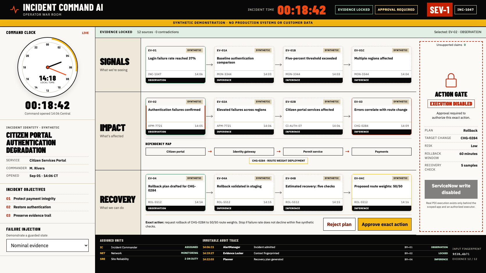

# Incident Command AI

An evidence-bound major-incident command system that connects operational signals to one approval-gated ServiceNow action.

> **Synthetic data only. Status:** public offline demonstration ready. Optional ServiceNow PDI integration evidence remains pending and is not required to run the project.



[Open the live demonstration](https://jermaine-anugwom.github.io/incident-command-ai/)

## Run it locally

Requires Git and Docker with Compose v2. Initial setup downloads dependencies and images; no model key or ServiceNow account is needed.

```bash
git clone https://github.com/Jermaine-Anugwom/incident-command-ai.git
cd incident-command-ai
docker compose up --build
```

Open the [command board](http://127.0.0.1:4173) or [API documentation](http://127.0.0.1:8000/docs).
The public board uses synthetic fixtures and cannot write to ServiceNow.

## Why this is forward deployed

The difficult part of enterprise AI is not producing prose. It is understanding the operator's real decision path, integrating with existing systems, isolating unreliable inputs, exposing uncertainty, constraining authority, and leaving behind something the customer team can operate.

Incident Command AI demonstrates that full loop:

- Correlates incidents, changes, CMDB relationships, and operator notes.
- Separates observations from inferences and cites every recommendation.
- Abstains on stale, contradictory, missing, or injection-tainted context.
- Shows the exact write proposed for ServiceNow.
- Requires a role-authorized approval over an unchanged fingerprint.
- Executes idempotently and preserves an auditable trace.
- Runs entirely offline with no model key or ServiceNow account.

## Command Sectors

The companion interface is organized around a command clock and three operational sectors:

1. **Signals** admits and inspects evidence.
2. **Impact** maps affected dependencies and displays a supported hypothesis.
3. **Recovery** proposes one bounded action and its rollback condition.

The guarded action gate remains closed until the exact plan receives a valid approval. The public demonstration records synthetic authorization but deliberately keeps the ServiceNow write disabled.

## Development setup

From the cloned repository, use Python 3.12 for the service and Node.js 22 for the companion.

### Service

```bash
python3.12 -m venv .venv
.venv/bin/pip install -e '.[dev]'
.venv/bin/uvicorn incident_command_ai.api:app --reload
```

Open `http://127.0.0.1:8000/docs`.

### Companion

```bash
cd companion
npm install
npm run dev
```

Open `http://127.0.0.1:3000`.

## Repository map

```text
servicenow/   scoped-app blueprint, Scripted REST resources, ATF contract
service/      FastAPI correlation, planning, approval, and execution boundary
companion/    Next.js incident command board
evaluations/  deterministic golden, adversarial, and failure cases
docs/         architecture, decisions, security, and operator handoff
```

## Safety boundary

This repository contains no production URL, credential, session, customer record, résumé data, or private product material. The public demo cannot write to ServiceNow. Any future PDI integration is non-production, synthetic-only, least-privilege, and approval-gated.

## Non-affiliation

ServiceNow is a trademark of ServiceNow, Inc. This independent demonstration is not affiliated with, endorsed by, or sponsored by ServiceNow. Its interface does not reproduce ServiceNow's proprietary UI.

## License

[MIT](LICENSE)
